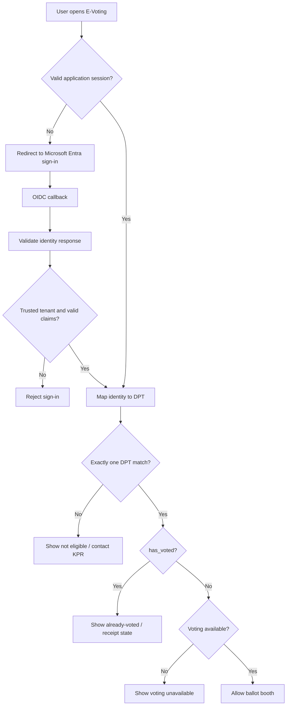

# Authentication & Authorization — E-Voting Pemira HMIF

| Metadata | Value |
|---|---|
| Document | Authentication & Authorization Specification |
| Project | E-Voting Pemira HMIF |
| Version | 0.1.0 |
| Status | Draft — Requires Identity and Security Review |
| Basis | PRD v1.0.0, UI.md, ARCHITECTURE.md, DATABASE.md, API.md, and project context supplied in the conversation |
| Last updated | 2026-10-31 |

> **Status convention**
>
> - **Specified**: explicitly supported by the current PRD or project context.
> - **Proposed**: a design recommendation, not yet an approved project decision.
> - **TBD**: information is missing and must be decided before implementation or release.

---

## 1. Purpose

This document defines how E-Voting Pemira HMIF authenticates a user, maps the authenticated identity to the voter whitelist (DPT), establishes an application session, and authorizes access to voter and administrative functions.

The system must distinguish three separate questions:

1. **Authentication:** Is this user signed in with a valid institutional identity?
2. **Eligibility:** Is this identity represented by an eligible record in `voters_whitelist`?
3. **Authorization:** Is this user allowed to perform the requested operation in the current election state?

A successful answer to the first question does not imply a successful answer to the second or third.

## 2. Source-backed requirements

The current PRD and project context establish the following:

- Voter authentication uses Microsoft Entra SSO.
- The application obtains an institutional identity claim such as email or `preferred_username`.
- The identity is matched against `voters_whitelist`.
- A person not found in the DPT must be denied access to the ballot flow.
- A voter whose `has_voted` flag is already true must not cast another vote.
- The project context identifies MSAL / Azure identity integration.
- The application uses server-side authorization for administrative features.
- The PRD expects a regular student to receive HTTP 403 from `GET /api/admin/tally`.
- The PRD mentions a superadmin manual override capability for DPT administration.

The following are **not yet established** by the source documents:

- The exact Entra tenant ID and supported account type.
- The canonical claim used to identify a student.
- The precise email-to-NIM mapping rule.
- The session library and token-storage implementation.
- The final role-permission matrix.
- Session lifetime and refresh behavior.
- The process for revoking access during an active election.
- The exact mechanism for assigning admin and superadmin roles.

These items remain decisions, not implementation facts.

## 3. Identity provider

### 3.1 Microsoft Entra ID

**Specified:** Microsoft Entra ID is the institutional identity provider for voter sign-in.

**TBD configuration values:**

| Configuration | Required value |
|---|---|
| App owner tenant ID | TBD; tenant created and personally managed by project owner |
| Allowed institutional tenant ID (`tid`) | Telkom University tenant ID; obtain and verify before production |
| Application / client ID | TBD |
| Client secret or certificate strategy | TBD; server-side only if used |
| Authority / issuer | TBD |
| Redirect URI(s) | TBD |
| Post-logout redirect URI | TBD |
| Allowed account type | Multitenant (accounts in any Microsoft Entra directory), restricted by application to Telkom University tenant ID |
| Required scopes | TBD; request only what the application needs |
| Allowed email domain | `student.telkomuniversity.ac.id`; supplementary check only, not a substitute for tenant/token validation |

Do not put client secrets, certificates, or privileged credentials in browser-accessible code or public environment variables.

### 3.2 Protocol and validation

**Proposed implementation baseline:** OpenID Connect (OIDC) authorization-code flow, using the approved MSAL / Entra integration for the Next.js application.

The server-side authentication layer must validate the identity response, including at minimum:

- Token signature and trusted signing key.
- Issuer.
- Audience / client ID.
- Expiration and not-before time.
- Nonce, where applicable.
- State / correlation protections for the authorization flow.
- Tenant identity against the approved tenant policy.

The application must not trust a decoded JWT merely because its payload can be read. Cryptographic and protocol validation must be performed by the identity library and/or trusted server-side middleware.

**TBD:** Confirm whether the implementation uses a dedicated authentication library, MSAL directly, or another approved integration. The current documentation does not verify the repository's actual auth configuration.

## 4. Identity claims and DPT mapping

### 4.1 Candidate claims

The PRD mentions email and `preferred_username`. These claims are possible inputs to the identity mapping process, but the source does not establish which one is canonical.

| Claim / attribute | Potential use | Current status |
|---|---|---|
| `sub` | Stable subject identifier within an issuer/client context | Must be evaluated; not specified by PRD |
| `oid` | Entra object identifier | Potential stable directory identifier; not specified by PRD |
| `tid` | Tenant identifier | Should be validated against approved tenant |
| `email` | Possible DPT email match | Mentioned by PRD; canonical status TBD |
| `preferred_username` | Possible institutional username / email match | Mentioned by PRD; canonical status TBD |
| `name` | Display name only | Not suitable as a unique identity key |

Do not use display name as an identity key. Names can change and are not guaranteed to be unique.

### 4.2 Recommended mapping strategy

**Approved direction:** DPT source file contains `nim`, `email`, `name`, and `generation` from KEMA for cohorts 2023–2026. Use verified institutional email to perform the initial DPT match. **Proposed stable binding:** after a successful match, persist `tid` + `oid` against that voter record and use the pair for subsequent sign-ins. Do not accept identity or NIM supplied by the browser.

The current DPT import schema contains `nim`, `email`, `name`, and `generation`; it does not contain Entra object IDs. The `tid` + `oid` binding is populated from a validated first sign-in and requires a migration plus a controlled account-linking procedure.

**Minimum safe mapping flow:**

1. Complete Entra authentication and validate the identity response.
2. Verify the issuer / tenant against the approved institutional tenant.
3. Obtain the selected canonical claim.
4. Normalize it using a documented rule (for example, case normalization for email, without changing meaningful characters).
5. Match the normalized identity to exactly one DPT record.
6. If there is no match, deny access to the ballot flow.
7. If more than one record matches, fail closed and raise an administrative data-quality issue.
8. Use the matched DPT record as the server-side source of voter identity for subsequent operations.

Do not silently fall back from one claim to another when the primary claim is missing or invalid. A fallback can create ambiguous or attacker-controlled identity mapping.

### 4.3 Email domain validation

The project context identifies `@student.telkomuniversity.ac.id` as the correct student email domain.

Domain validation is a useful preliminary check, but it is not sufficient proof of eligibility. The authoritative eligibility check remains the DPT match.

**Decision:** accept only the approved Telkom University tenant ID; additionally validate the institutional email domain as a secondary control. Define handling for aliases and legacy addresses before production.

## 5. Authentication and eligibility flow

### 5.1 High-level flow

The diagram expresses the intended product flow. The exact redirect and session mechanics depend on the approved authentication library.

### 5.2 Detailed steps

1. A visitor opens the application.
2. If no valid application session exists, the application starts Entra sign-in.
3. Entra authenticates the user and returns the protocol response to the configured callback.
4. The server validates the response and establishes a trusted identity context.
5. The server maps that identity to the DPT.
6. The application checks `has_voted`.
7. The application checks whether voting is currently available and whether maintenance mode blocks the flow.
8. Only a valid, eligible, not-yet-voted user is allowed into the ballot booth.

### 5.3 Failure behavior

| Condition | Expected behavior |
|---|---|
| User cancels sign-in | Return to sign-in entry state; do not create an authenticated session |
| Invalid token / issuer / audience | Reject authentication |
| Wrong tenant | Reject authentication |
| Required identity claim missing | Fail closed; do not guess another identity |
| No DPT match | Deny ballot access and show a safe explanation |
| Multiple DPT matches | Deny ballot access and flag data-quality issue |
| `has_voted = true` | Do not allow ballot casting; show already-voted state |
| Voting closed | Do not allow ballot casting |
| Maintenance mode active | Follow approved maintenance UX; ballot operation remains unavailable |

## 6. Application session lifecycle

### 6.1 Session contents

**Proposed:** Keep the application session minimal. It may contain or reference:

- Authenticated issuer and subject identifier.
- Tenant identifier.
- Internal DPT voter record identifier, accessible only server-side.
- Role / permission claims or a server-side role lookup reference.
- Session creation and expiry metadata.

Avoid copying unnecessary personal information or access tokens into client-readable session data.

**Important:** A session may associate an authenticated user with a DPT record. That association must not be written into a ballot row or a log that can be correlated with an individual ballot.

### 6.2 Cookie controls

The PRD requires:

- HTTP-Only cookies.
- Secure cookies.
- SameSite=Strict.

These controls should be applied to the application session cookie where compatible with the selected OIDC callback and sign-in flow.

**Review note:** `SameSite=Strict` can affect cross-site identity-provider redirects and callback behavior. Test the complete Entra sign-in and sign-out flow in real browsers before finalizing the cookie policy. Do not weaken cookie protections without documenting the exact compatibility issue and compensating controls.

### 6.3 Session lifetime

The PRD states a maximum JWT lifetime of 15 minutes in the ballot booth.

This is a stated requirement, but the exact meaning is not defined: it could refer to an application session token, access token, or a specific short-lived ballot authorization token.

**Proposed interpretation pending approval:**

- Enforce a maximum 15-minute lifetime for the credential/token used to authorize ballot-booth operations.
- Require revalidation or renewal through the trusted session mechanism when it expires.
- Do not assume that refreshing a session should reset or bypass the DPT `has_voted` check.
- Ensure a user cannot cast a ballot using an expired or revoked session.

**TBD:** Define idle timeout, absolute session lifetime, refresh behavior, and whether the 15-minute requirement applies to the whole application session or only the ballot-booth authorization context.

### 6.4 Logout and revocation

Logout should invalidate the local application session and, where configured, initiate the approved Entra sign-out flow.

**TBD:**

- Whether logout must also terminate the Entra SSO session.
- How administrators revoke a user's application access.
- How role changes take effect for existing sessions.
- How a compromised account is blocked during an active election.
- Whether session revocation is immediate or bounded by token expiry.

## 7. Authorization model

### 7.1 Approved role-permission matrix (decision: 2026-10-31)

The administrative source of truth is a database-backed administrator whitelist with explicit roles. Role membership is provisioned and revoked by an authorized superadmin. Entra authentication proves identity; it does not automatically grant administrative privileges.

| Capability | Voter | `kpr_admin` | `auditor` | `super_admin` |
|---|---:|---:|---:|---:|
| Sign in | Yes | Yes | Yes | Yes |
| Access ballot when eligible and not voted | Yes | No, unless separately eligible as voter | No, unless separately eligible as voter | No, unless separately eligible as voter |
| Read own eligibility / participation status | Yes | No | No | No |
| View turnout aggregates | No | Yes | Yes | Yes |
| View live candidate tally before official close | No | Yes, only while authorized by election policy | No | No by default |
| View final tally after official release | No | Yes | Yes | Yes |
| Import / validate / commit DPT | No | Yes | No | Yes |
| Correct DPT record through audited override | No | Yes, with reason and audit event | No | Yes, with reason and audit event |
| Manage candidate profiles and active status | No | Yes | No | Yes |
| Open / close voting and change election settings | No | Yes | No | Yes |
| Export official reports | No | Yes | Yes, read-only report scope | Yes |
| Read administrative audit logs | No | Yes, operational scope | Yes | Yes |
| Manage administrator whitelist and roles | No | No | No | Yes |
| Change technical/security configuration | No | No | No | Yes |
| Read individual ballot rows or link a ballot to a voter | No | No | No | No |

**Role definitions:**

- `voter`: eligibility comes from the DPT, not from the administrator table. A user can be a voter and, if separately authorized, an administrator; the ballot operation must still derive voter identity from the validated server session.
- `kpr_admin`: election operator for DPT, candidate, election-window, turnout, authorized live tally, and official reporting workflows.
- `auditor`: read-only oversight role for audit events, turnout, and released final reports. No DPT mutation, election-setting mutation, or pre-close candidate tally access.
- `super_admin`: technical and access-control administrator. Can manage admin membership and system configuration, but does not receive a default permission to inspect individual ballots or pre-close candidate tally.

This matrix is the approved project baseline. Any additional role or permission change requires an explicit project decision and a documented audit trail. The matrix does not override KPR regulations or the rule that candidate tally remains private from the public until official close.

### 7.1.1 Administrator whitelist data model

**Approved direction:** use a database table such as `admin_users` with a unique identity binding (`entra_tenant_id`, `entra_object_id`), normalized institutional email for display/contact, explicit `role`, `is_active`, `created_at`, `updated_at`, and provisioning metadata (`created_by`). Exact SQL types and constraints must be finalized in `DATABASE.md` before migration. Do not authorize by email-domain suffix alone.

### 7.2 Authorization principles

- Deny by default.
- Grant the minimum permission required for a task.
- Check permission on the server for every protected operation.
- Do not rely on hidden navigation links or client-side route guards.
- Separate permission to view turnout from permission to view candidate tally.
- Separate DPT management from ballot access.
- Record privileged changes in the audit system.
- Do not grant access to ballot-to-voter linkage; the system design must not provide such a linkage.

### 7.3 Role assignment and lifecycle

- The `admin_users` database whitelist is the single source of truth for administrative roles.
- A superadmin provisions an administrator only after identity verification and an approved appointment by the election organization.
- The application resolves the authenticated Entra identity (`tid` + `oid`) to one active admin record and reads the role from the database on the server.
- No role is accepted from browser input, editable profile fields, email domain, or untrusted token metadata.
- Role changes, activation, deactivation, and failed administrative access attempts must be audited.
- Revocation must take effect on the next protected server-side authorization check; session caching must not allow a removed admin to retain access until a long-lived session expires.
- At least two trusted people should have a documented recovery/continuity process for the personally owned Entra tenant, without sharing passwords or client secrets.

## 8. Ballot authorization boundary

The ballot-casting operation is especially sensitive because the database RPC described in the PRD accepts `p_nim`.

**Required control:** The server must derive the NIM from the validated session-to-DPT mapping. The browser must not choose the NIM used for the transaction.

The server-side flow should be:

1. Validate the current session.
2. Resolve the current identity to exactly one DPT record.
3. Obtain the NIM from that trusted record.
4. Validate the submitted candidate ID.
5. Invoke the secure database transaction.
6. Return only a safe business result and the approved receipt artifact.

The database function's `SECURITY DEFINER` privileges, owner, `search_path`, and execute grants must be reviewed separately in `DATABASE.md`. Authentication at the web layer does not automatically make a privileged database function safe if it can be called directly by an unauthorized database role.

## 9. Security controls

### 9.1 Required controls

- [ ] Validate OIDC responses server-side.
- [ ] Validate issuer, audience, tenant, expiry, and protocol protections.
- [ ] Select and document one canonical identity claim.
- [ ] Match identity to exactly one DPT record.
- [ ] Fail closed when identity mapping is ambiguous.
- [ ] Enforce the institutional student domain according to approved policy.
- [ ] Keep secrets and privileged credentials server-side.
- [ ] Use HTTP-Only, Secure, and approved SameSite cookie settings.
- [ ] Define and enforce the 15-minute ballot-booth token/session requirement.
- [ ] Re-check eligibility and `has_voted` at vote-casting time.
- [ ] Enforce authorization on every administrative operation.
- [ ] Prevent client-supplied NIM from controlling ballot identity.
- [ ] Implement logout and session revocation behavior.
- [ ] Avoid logging tokens, authorization headers, or unnecessary personal data.
- [ ] Review CSRF protections for cookie-authenticated state-changing operations.
- [ ] Review redirect URI allowlists and open-redirect protections.
- [ ] Test sign-in and callback behavior across supported browsers.

### 9.2 Privacy boundary

Authentication records and voter whitelist records contain identity data. Ballot records must remain separate.

Do not:

- Add `voter_id`, NIM, email, or session ID to `ballots`.
- Add an identity-to-ballot mapping table.
- Include candidate choice in a voter's receipt or status response.
- Add session identifiers to ballot rows.
- Log request data that makes an individual ballot traceable to a voter.

The application may need to know whether a voter has voted, through the whitelist's `has_voted` state. That state must not expose which candidate was selected.

## 10. Authentication and authorization test plan

| Test ID | Scenario | Expected result |
|---|---|---|
| AUTH-T01 | Sign in with valid institutional Entra account | Valid application session established |
| AUTH-T02 | Sign-in response has invalid signature / issuer / audience | Authentication rejected |
| AUTH-T03 | Sign-in response belongs to unapproved tenant | Authentication rejected |
| AUTH-T04 | Required canonical identity claim is missing | Fail closed |
| AUTH-T05 | Valid identity has no DPT match | Ballot access denied |
| AUTH-T06 | Identity maps to more than one DPT row | Ballot access denied and issue surfaced |
| AUTH-T07 | Identity maps to one eligible DPT row with `has_voted=false` | Ballot booth allowed only when voting is available |
| AUTH-T08 | Identity maps to a DPT row with `has_voted=true` | Ballot booth denied; already-voted state shown |
| AUTH-T09 | Student requests admin tally | HTTP 403 |
| AUTH-T10 | Student invokes DPT import operation | HTTP 403 |
| AUTH-T11 | Admin role is removed while session exists | Access follows approved revocation policy |
| AUTH-T12 | Session / ballot token is expired | Protected operation rejected |
| AUTH-T13 | User logs out and reuses old application session | Old session rejected |
| AUTH-T14 | Browser submits a different NIM from the signed-in user's DPT record | Server ignores/rejects supplied NIM; cannot impersonate |
| AUTH-T15 | Cookie flags are inspected in production-like environment | HTTP-Only, Secure, and approved SameSite policy present |
| AUTH-T16 | OIDC callback receives untrusted redirect target | Open redirect prevented |
| AUTH-T17 | Cross-site state-changing request is attempted | CSRF protection behaves as designed |
| AUTH-T18 | Inspect ballot and application logs after a vote | No direct voter-to-ballot linkage is present |

## 11. Open decisions

| ID | Decision required | Why it matters |
|---|---|---|
| AUTH-DEC-01 | Entra tenant ID and supported account type | Defines trusted identity boundary |
| AUTH-DEC-02 | Canonical identity claim (`oid`, `sub`, email, or `preferred_username`) | Prevents ambiguous user mapping |
| AUTH-DEC-03 | Email-to-NIM mapping and normalization | Prevents identity spoofing and false matches |
| AUTH-DEC-04 | Whether DPT schema stores Entra object ID | Determines long-term identity stability |
| AUTH-DEC-05 | Authentication library and actual callback configuration | Aligns documentation with implementation |
| AUTH-DEC-06 | Exact scope of the 15-minute JWT requirement | Defines session and ballot authorization lifetime |
| AUTH-DEC-07 | Idle timeout and absolute session lifetime | Controls exposure from unattended sessions |
| AUTH-DEC-08 | Refresh-token and renewal behavior | Controls continuity and revocation |
| AUTH-DEC-09 | SameSite policy compatibility with Entra callback | Avoids breaking sign-in or weakening CSRF controls |
| AUTH-DEC-10 | Admin role source of truth | Prevents unauthorized privilege assignment |
| AUTH-DEC-11 | Permission matrix for KPR, Admin, Superadmin | Defines least-privilege access |
| AUTH-DEC-12 | Admin account provisioning and review process | Controls privileged access |
| AUTH-DEC-13 | Session revocation and role-change propagation | Controls access after account/role changes |
| AUTH-DEC-14 | Logout behavior with Entra SSO | Defines local vs provider session termination |
| AUTH-DEC-15 | Student email domain enforcement and exception policy | Prevents non-institutional identities from entering the voter flow |

## 12. Completion criteria

This document can move from Draft to Approved when:

1. Entra tenant and application configuration are confirmed.
2. The canonical identity claim is selected.
3. Identity-to-DPT mapping is fully specified.
4. Ambiguous and missing identity mappings fail closed.
5. The session library and callback configuration match the actual repository.
6. The 15-minute requirement is interpreted and implemented.
7. Cookie and CSRF behavior is tested end-to-end.
8. The approved role-permission matrix and database-backed role lookup are implemented and tested.
9. Role provisioning, revocation, and session refresh behavior are tested.
10. Ballot casting derives NIM only from trusted server-side identity mapping.
11. Authentication, authorization, and privacy tests pass.

## 13. Next document

**Next in sequence: `SECURITY.md`** — threat model, trust boundaries, abuse cases, database and application hardening, privacy controls, and security verification.

---

## Change log

| Version | Date | Changes |
|---|---|---|
| 0.1.0 | 2026-10-31 | Initial authentication and authorization specification based on current project documentation and supplied technical context |

## 10. Confirmed project-specific Entra decisions (2026-10-31)

- The project owner creates and personally manages the Entra tenant using an account outside the Telkom University domain.
- The app registration is multitenant so institutional accounts from Telkom University can authenticate.
- The application must still allow only the verified Telkom University `tid`; multitenant does **not** mean unrestricted access from all tenants.
- DPT is supplied by KEMA for cohorts 2023, 2024, 2025, and 2026, with required fields `nim`, `email`, `name`, and `generation`.
- After server-side token validation, the application matches the institutional email to exactly one DPT row. On successful initial linking, store the verified `tid` + `oid` pair for stable subsequent identity resolution.
- DPT mismatch, duplicate match, invalid tenant, or missing required claims must fail closed.
- Tenant ownership remains personal by explicit project decision. Document account recovery, MFA, credential rotation, backup administrator access, and handover risk.

**Production gate:** test sign-in using an actual Telkom University student account. The Telkom tenant may restrict user consent or require administrator consent for the multitenant application. Do not assume successful sign-in until this is tested.

## 11. Development authentication and dummy accounts (decision: 2026-10-31)

- Initial development and functional testing will use synthetic/dummy accounts and a local or isolated mock authentication provider.
- Seeded dummy DPT rows must use synthetic NIMs and non-deliverable/test email addresses; never import real student records into development unless explicitly authorized and protected.
- Dummy authentication must be enabled only in development/test environments, guarded by an explicit environment setting, and must fail closed in production.
- The dummy provider must exercise the same application identity-to-DPT and role-authorization interfaces as the Entra provider; it must not bypass DPT eligibility or authorization checks.
- After the official Telkom University tenant ID is obtained, perform a separate integration test with an authorized real student account and verify tenant restriction, consent policy, claims, and DPT linking. Do not use a real production election ballot for this test.
