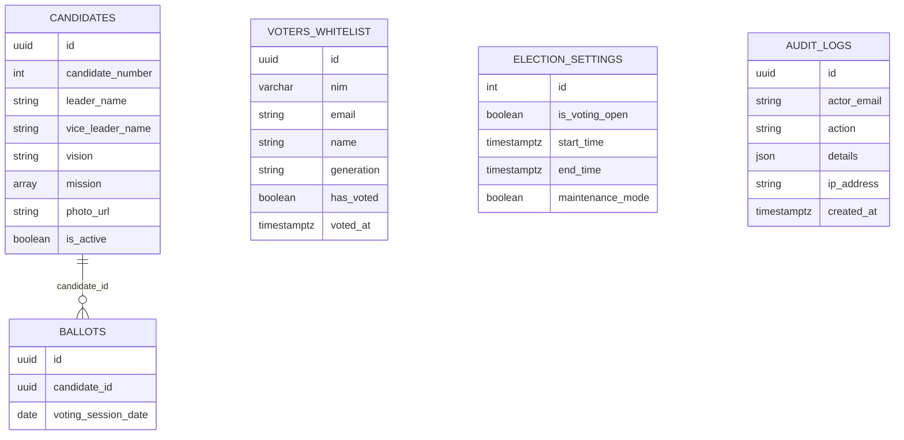

# DATA_DICTIONARY.md

> **Project:** E-Voting Pemira HMIF  
> **Document:** Data Dictionary  
> **Version:** 0.1.0  
> **Status:** Draft — Requires Database, Product, and Security Review  
> **Last updated:** 2026-10-31  
> **Primary sources:** `PRD.md` v1.0.0 and `DATABASE.md` v0.1.0  
> **Audience:** Developers, database maintainers, testers, administrators, and auditors

---

## 1. Tujuan dan Konvensi

Dokumen ini mendefinisikan struktur data logis yang tercantum dalam spesifikasi E-Voting Pemira HMIF. Dokumen ini membantu tim memahami arti kolom, tipe data, constraint, relasi, dan sensitivitas data.

Dokumen ini **bukan pengganti migration SQL** dan tidak membuktikan bahwa schema telah diterapkan pada database.

### 1.1 Label status

- **Specified:** disebutkan dalam PRD atau database design yang menjadi sumber acuan.
- **Derived:** penjelasan yang diturunkan langsung dari struktur/constraint yang disebutkan.
- **TBD:** detail belum ditentukan atau perlu diverifikasi pada migration aktual.

### 1.2 Konvensi tipe data

Tipe data di bawah mengikuti istilah PostgreSQL yang tercantum atau tersirat dalam spesifikasi. Detail seperti panjang maksimum, nullability, default, dan constraint harus diverifikasi terhadap DDL final.

### 1.3 Klasifikasi sensitivitas

| Klasifikasi | Makna |
|---|---|
| **Public** | Informasi yang memang disetujui untuk ditampilkan kepada publik. |
| **Internal** | Informasi operasional yang tidak untuk publik umum. |
| **Confidential** | Data pribadi atau informasi yang hanya boleh diakses sesuai kebutuhan dan otorisasi. |
| **Restricted** | Data/metadata yang memiliki risiko tinggi bila disalahgunakan atau dikorelasikan. |

Klasifikasi dalam dokumen ini merupakan usulan berdasarkan fungsi data. Kebijakan klasifikasi resmi: **TBD**.

---

## 2. Ringkasan Entitas

PRD mencantumkan lima tabel utama:

| Tabel | Fungsi | Klasifikasi umum |
|---|---|---|
| `voters_whitelist` | Daftar pemilih dan status penggunaan hak pilih. | Confidential |
| `candidates` | Informasi kandidat dan opsi pemilihan. | Public/Internal |
| `ballots` | Catatan suara tanpa identitas pemilih. | Restricted |
| `election_settings` | Konfigurasi periode dan status pemungutan suara. | Internal |
| `audit_logs` | Jejak aktivitas administratif/sistem. | Restricted |

---

## 3. `voters_whitelist`

### 3.1 Fungsi

Menyimpan data pemilih yang memenuhi syarat berdasarkan DPT, serta status apakah pemilih telah menggunakan hak pilih.

### 3.2 Definisi kolom

| Kolom | Tipe data | Constraint/default yang disebut | Deskripsi | Sensitivitas |
|---|---|---|---|---|
| `id` | UUID | Primary key (detail constraint perlu verifikasi) | Identifier internal record pemilih. | Confidential |
| `nim` | VARCHAR(15) | Unique | Nomor Induk Mahasiswa. | Confidential |
| `email` | Tipe belum dinyatakan eksplisit | Unique | Email institusi yang digunakan untuk pencocokan identitas. | Confidential |
| `name` | Tipe belum dinyatakan eksplisit | TBD | Nama pemilih. | Confidential |
| `generation` | Tipe belum dinyatakan eksplisit | TBD | Angkatan pemilih. | Internal/Confidential |
| `has_voted` | Boolean | Default `false` | Menandakan apakah hak pilih telah digunakan. | Confidential |
| `voted_at` | TIMESTAMPTZ | TBD | Waktu pencatatan status pemilih telah memilih. | Restricted |
| `created_at` | Tipe/default perlu verifikasi | TBD | Waktu record dibuat. | Internal |

**Catatan privasi:** `voted_at` berada pada record pemilih, sedangkan PRD melarang precise timestamp pada record ballot. Pemisahan ini tidak otomatis menghilangkan risiko korelasi waktu antara log pemilih dan ballot. Retensi dan akses terhadap timestamp harus ditinjau.

### 3.3 Aturan data

- `nim` harus unik.
- `email` harus unik.
- Domain email mahasiswa yang ditetapkan dalam spesifikasi adalah `@student.telkomuniversity.ac.id`.
- `has_voted` secara default bernilai `false`.
- Perubahan `has_voted` harus terjadi melalui alur voting yang sah atau prosedur koreksi yang disetujui.
- Jangan menganggap data `voters_whitelist` sebagai data publik.

### 3.4 Hal yang belum ditentukan

- Tipe data dan panjang maksimum `email`, `name`, dan `generation`.
- Apakah email disimpan dalam bentuk normalized/lowercase.
- Aturan validasi format NIM.
- Nullability seluruh kolom.
- Default dan timezone semantics `created_at`.
- Kebijakan retensi `voted_at`.
- Prosedur koreksi data DPT.

---

## 4. `candidates`

### 4.1 Fungsi

Menyimpan data kandidat Ketua/Wakil Ketua dan opsi pemilihan yang ditampilkan pada halaman ballot.

### 4.2 Definisi kolom

| Kolom | Tipe data | Constraint/default yang disebut | Deskripsi | Sensitivitas |
|---|---|---|---|---|
| `id` | UUID | Primary key (detail perlu verifikasi) | Identifier internal kandidat. | Internal |
| `candidate_number` | Tipe data perlu verifikasi | Unique; `0` digunakan untuk Kotak Kosong menurut komentar PRD | Nomor urut/identitas opsi kandidat. | Public |
| `leader_name` | Tipe data perlu verifikasi | TBD | Nama calon Ketua HMIF. | Public |
| `vice_leader_name` | Tipe data perlu verifikasi | TBD | Nama calon Wakil Ketua HMIF. | Public |
| `vision` | Tipe data perlu verifikasi | TBD | Pernyataan visi. | Public |
| `mission` | TEXT[] | TBD | Daftar misi kandidat. | Public |
| `photo_url` | Tipe data perlu verifikasi | TBD | Referensi URL foto kandidat. | Public |
| `is_active` | Boolean | TBD | Menandakan opsi kandidat aktif untuk pemilihan. | Internal/Public |

### 4.3 Aturan data

- `candidate_number` harus unik.
- PRD memberi konvensi nomor `0` untuk Kotak Kosong.
- Kandidat yang tidak aktif tidak boleh dipilih oleh RPC voting.
- Informasi kandidat yang tampil harus sesuai data yang telah disahkan panitia.

### 4.4 Hal yang belum ditentukan

- Tipe data `candidate_number`.
- Panjang maksimum nama dan visi.
- Aturan jumlah elemen `mission`.
- Format dan lokasi penyimpanan foto.
- Apakah Kotak Kosong direpresentasikan sebagai record pada tabel `candidates` atau melalui mekanisme lain. PRD mengarah pada nomor kandidat `0`, tetapi implementasi final perlu diverifikasi.
- Prosedur aktivasi/nonaktivasi setelah voting dibuka.

---

## 5. `ballots`

### 5.1 Fungsi

Menyimpan pilihan suara tanpa menyimpan identifier pemilih pada record ballot.

### 5.2 Definisi kolom

| Kolom | Tipe data | Constraint/default yang disebut | Deskripsi | Sensitivitas |
|---|---|---|---|---|
| `id` | UUID | Primary key (detail perlu verifikasi) | Identifier internal record ballot. | Restricted |
| `candidate_id` | UUID | Foreign key ke `candidates.id`; `ON DELETE RESTRICT` | Opsi kandidat yang dipilih. | Restricted |
| `voting_session_date` | DATE | Default `CURRENT_DATE` | Tanggal sesi pemungutan suara. | Restricted |

### 5.3 Larangan data identitas

Sesuai PRD, tabel `ballots` tidak boleh memiliki:

- `voter_id`;
- NIM;
- IP address;
- session ID;
- precise timestamp.

Tujuannya adalah memisahkan identitas pemilih dari pilihan suara.

### 5.4 Aturan integritas

- `candidate_id` harus merujuk ke kandidat yang valid.
- Penghapusan kandidat yang telah dirujuk ballot dibatasi oleh `ON DELETE RESTRICT`.
- Ballot disimpan dalam transaksi voting yang atomik bersama perubahan status pemilih.
- Satu pemilih hanya boleh menghasilkan satu ballot melalui alur voting yang sah.

**Penting:** struktur tabel yang tidak menyimpan identitas pemilih belum cukup untuk membuktikan ballot secrecy secara end-to-end. Trigger, RPC, log, timestamp, telemetry, backup, dan akses administratif juga perlu ditinjau untuk mencegah korelasi.

### 5.5 Hal yang belum ditentukan

- Apakah ada unique constraint tambahan.
- Strategi indeks dan partitioning.
- Kebijakan retensi dan penghapusan ballot.
- Apakah tanggal sesi merupakan tanggal database atau zona waktu operasional yang ditetapkan.
- Mekanisme audit integritas agregat tanpa menghubungkan pemilih dengan pilihan.

---

## 6. `election_settings`

### 6.1 Fungsi

Menyimpan konfigurasi global pemungutan suara.

### 6.2 Definisi kolom

| Kolom | Tipe data | Constraint/default yang disebut | Deskripsi | Sensitivitas |
|---|---|---|---|---|
| `id` | INT | Default `1`; CHECK `id = 1` | Identifier singleton settings record. | Internal |
| `is_voting_open` | Boolean | TBD | Status apakah pemungutan suara dibuka. | Internal |
| `start_time` | TIMESTAMPTZ | TBD | Waktu mulai pemungutan suara. | Internal |
| `end_time` | TIMESTAMPTZ | TBD | Waktu akhir pemungutan suara. | Internal |
| `maintenance_mode` | Boolean | TBD | Status mode pemeliharaan. | Internal |

### 6.3 Aturan data

- `id` dibatasi agar hanya bernilai `1`, sesuai desain singleton.
- Status voting dan rentang waktu harus diperiksa pada server.
- PRD menyebut voting hanya terbuka jika `is_voting_open` aktif dan waktu saat ini berada dalam rentang `start_time` dan `end_time`.
- Mode pemeliharaan harus ditangani sesuai prosedur operasional yang disetujui.

### 6.4 Hal yang belum ditentukan

- Default untuk seluruh boolean.
- Nullability dan aturan validasi rentang waktu.
- Perilaku jika `start_time` atau `end_time` null.
- Prioritas antara `maintenance_mode` dan `is_voting_open`.
- Siapa yang boleh mengubah settings dan apakah diperlukan persetujuan dua pihak.
- Zona waktu operasional resmi.

---

## 7. `audit_logs`

### 7.1 Fungsi

Mencatat tindakan administratif dan kejadian yang diperlukan untuk akuntabilitas serta investigasi.

### 7.2 Definisi kolom

| Kolom | Tipe data | Constraint/default yang disebut | Deskripsi | Sensitivitas |
|---|---|---|---|---|
| `id` | UUID | Primary key (detail perlu verifikasi) | Identifier record audit. | Restricted |
| `actor_email` | Tipe data perlu verifikasi | TBD | Identitas aktor yang melakukan tindakan. | Confidential |
| `action` | Tipe data perlu verifikasi | TBD | Jenis tindakan yang dicatat. | Internal |
| `details` | JSONB | TBD | Detail tindakan dalam format JSON. | Restricted |
| `ip_address` | Tipe data perlu verifikasi | TBD | Alamat IP terkait tindakan, jika dicatat. | Restricted |
| `created_at` | TIMESTAMPTZ | TBD | Waktu kejadian audit. | Restricted |

### 7.3 Aturan privasi dan keamanan

- Batasi akses audit log.
- Hindari menyimpan password, token, cookie, secret, atau payload sensitif yang tidak diperlukan.
- Jangan menaruh pilihan kandidat bersama identitas aktor/pemilih.
- Hindari detail log yang dapat menghubungkan identitas pemilih dengan pilihan ballot.
- Lindungi log dari perubahan dan penghapusan tidak sah.
- Tentukan retensi dan prosedur akses.

Kombinasi `actor_email`, `ip_address`, `created_at`, dan `details` dapat menimbulkan risiko korelasi. Isi `details` harus dibatasi dan ditinjau secara khusus.

### 7.4 Hal yang belum ditentukan

- Apakah audit log hanya untuk aktivitas admin atau juga event sistem.
- Daftar nilai `action` yang diperbolehkan.
- Skema JSON `details`.
- Kebijakan retensi dan immutable storage.
- Kebijakan IP logging dan masking.
- Siapa yang boleh membaca/mengekspor log.

---

## 8. Relasi Antarentitas

Relasi yang disebut dalam spesifikasi:

| Entitas sumber | Kolom | Entitas tujuan | Kolom tujuan | Jenis |
|---|---|---|---|---|
| `ballots` | `candidate_id` | `candidates` | `id` | Foreign key, `ON DELETE RESTRICT` |

PRD menyatakan bahwa `ballots` tidak memiliki relasi identitas langsung ke `voters_whitelist`.

Relasi lain tidak boleh diasumsikan tanpa DDL/migration final.

### 8.1 Diagram relasi konseptual

Diagram menunjukkan relasi yang dinyatakan dan struktur konseptual; bukan representasi lengkap seluruh constraint SQL.

---

## 9. Data Flow dan Sensitivitas

| Alur | Data yang terlibat | Risiko utama | Kontrol yang diperlukan |
|---|---|---|---|
| Login dan pencocokan DPT | Identity claims, email, NIM, record pemilih | Salah identifikasi atau akses tanpa hak | Validasi issuer/claim dan pencocokan server-side |
| Menampilkan kandidat | Data kandidat | Data kandidat salah/tidak sah | Verifikasi dan kontrol perubahan |
| Mengirim suara | Candidate ID, status pemilih, ballot | Double vote, manipulasi, korelasi identitas | Atomic RPC, row lock, validasi kandidat, pemisahan data |
| Dashboard partisipasi | Status `has_voted` dan data agregat | Kebocoran data pemilih | Agregasi dan pembatasan akses |
| Tally | Ballot dan candidate ID | Hasil privat terbuka | RBAC dan endpoint authorization |
| Audit | Aktor, aksi, IP, waktu, detail | Korelasi identitas dengan pilihan | Minimization, masking, access control, retention |

---

## 10. Aturan Retensi dan Penghapusan

Sumber yang tersedia belum menetapkan periode retensi final.

Hal yang perlu ditentukan:

- berapa lama data DPT disimpan setelah pemilihan;
- apakah `voted_at` perlu dipertahankan dan untuk berapa lama;
- berapa lama ballot disimpan;
- berapa lama audit log disimpan;
- siapa yang menyetujui penghapusan;
- bagaimana backup dan salinan ekspor ditangani;
- bagaimana penghapusan dilakukan tanpa merusak kebutuhan audit dan integritas hasil.

Jangan menghapus data produksi hanya berdasarkan keputusan developer. Penghapusan harus mengikuti kebijakan retensi yang disahkan.

---

## 11. Validasi dan Constraint yang Perlu Diverifikasi

| Area | Constraint/validasi | Status |
|---|---|---|
| DPT | `nim` unique | Specified |
| DPT | `email` unique | Specified |
| DPT | Email domain institusi | Specified pada aturan sistem; constraint DB perlu verifikasi |
| DPT | Format NIM | TBD |
| Kandidat | `candidate_number` unique | Specified |
| Kandidat | Nomor `0` untuk Kotak Kosong | Disebut dalam komentar PRD; implementasi perlu verifikasi |
| Kandidat | Kandidat harus aktif saat voting | Specified pada alur RPC |
| Ballot | FK `candidate_id` ke kandidat | Specified |
| Ballot | `ON DELETE RESTRICT` | Specified |
| Ballot | Tidak menyimpan identitas pemilih | Specified |
| Election settings | Singleton `id = 1` | Specified |
| Voting transaction | Atomic update status pemilih dan insert ballot | Specified |
| Voting concurrency | Row lock pada record pemilih | Specified |
| Audit | Detail log tidak boleh mengungkap pilihan pemilih | Derived security requirement; perlu review |

---

## 12. Keputusan yang Masih TBD

| ID | Keputusan | Dampak |
|---|---|---|
| DD-01 | Tipe dan panjang kolom yang belum eksplisit | Konsistensi schema dan validasi |
| DD-02 | Nullability dan default seluruh kolom | Integritas data |
| DD-03 | Format/normalisasi email dan NIM | Pencocokan DPT |
| DD-04 | Representasi record Kotak Kosong | Konsistensi UI, RPC, dan tally |
| DD-05 | Constraint tambahan pada ballot | Integritas dan pencegahan duplikasi |
| DD-06 | Zona waktu `voted_at` dan election settings | Konsistensi waktu |
| DD-07 | Isi dan skema `audit_logs.details` | Keamanan dan auditability |
| DD-08 | Retensi setiap tabel | Privasi dan kebutuhan audit |
| DD-09 | Indeks dan strategi performa | Kinerja query |
| DD-10 | Kebijakan backup dan penghapusan | Recovery dan lifecycle data |
| DD-11 | Klasifikasi data resmi | Kontrol akses dan distribusi |
| DD-12 | Mekanisme rekonsiliasi tanpa menghubungkan pemilih dan ballot | Integritas hasil dan ballot secrecy |

---

## 13. Riwayat Perubahan

| Versi | Tanggal | Perubahan |
|---|---|---|
| 0.1.0 | 2026-10-31 | Draft awal kamus data berdasarkan PRD dan DATABASE. |

---

## 14. Dokumen Terkait

- `PRD.md`
- `DATABASE.md`
- `ARCHITECTURE.md`
- `API.md`
- `AUTHENTICATION.md`
- `SECURITY.md`
- `TESTING.md`
- `OPERATIONS.md`
- `ADMIN_GUIDE.md`
- `ENVIRONMENT.md`

**Release gate:** verifikasi seluruh tipe data, nullability, default, index, constraint, dan relasi terhadap migration SQL aktual sebelum dokumen ini dipakai sebagai acuan implementasi atau audit.
