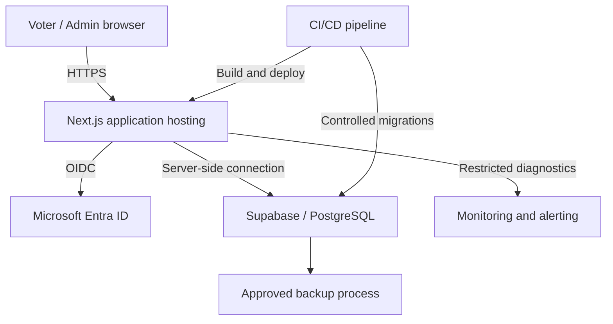

# Deployment & Operations Specification — E-Voting Pemira HMIF

| Metadata | Value |
|---|---|
| Document | Deployment & Operations Specification |
| Project | E-Voting Pemira HMIF |
| Version | 0.1.0 |
| Status | Draft — Requires Infrastructure and Security Review |
| Basis | PRD v1.0.0, UI.md, ARCHITECTURE.md, DATABASE.md, API.md, AUTHENTICATION.md, SECURITY.md, TESTING.md, and project context supplied in the conversation |
| Last updated | 2026-10-31 |

> **Status convention**
>
> - **Specified**: explicitly supported by the current project documentation or supplied project context.
> - **Proposed**: recommended operational practice, not yet an approved project decision.
> - **TBD**: provider, value, procedure, or operational owner has not been established.
>
> This document is a deployment plan, not evidence that a production environment has been provisioned or that deployment has succeeded.

---

## 1. Purpose

This document defines the deployment and operational baseline for E-Voting Pemira HMIF, from local development through staging and production.

Deployment must preserve the system's key guarantees:

- Only approved institutional identities can access the voter flow.
- DPT eligibility is checked by trusted server-side logic.
- Vote casting remains atomic and concurrency-safe.
- Ballot secrecy is preserved across application, database, logs, backups, and exports.
- Administrative capabilities and tally data remain restricted.
- A production incident can be detected and handled without silently compromising election integrity.

## 2. Known technical baseline

The project context supplied so far identifies:

| Area | Technology / requirement | Status |
|---|---|---|
| Web framework | Next.js App Router | Supplied project context |
| Language | TypeScript | Supplied project context |
| Database platform | Supabase / PostgreSQL | PRD and project context |
| Identity provider | Microsoft Entra ID | PRD |
| Identity integration | MSAL / Azure provider | Supplied project context; exact library/configuration TBD |
| Validation | Zod at Server Action / Route Handler boundaries | Supplied project context |
| E2E testing | Playwright | Supplied project context |
| Package manager | pnpm | Supplied project context |
| Typecheck | `pnpm tsc --noEmit` | Supplied project context |
| Hosting provider | Not established | TBD |
| CI/CD provider | Not established | TBD |
| Domain and DNS | Not established | TBD |
| Monitoring provider | Not established | TBD |

The actual repository configuration, scripts, hosting manifests, and environment-variable names have not been verified in this documentation pass. Confirm them from the project repository before implementing this document as a deployment runbook.

## 3. Deployment environments

### 3.1 Environment model

**Proposed minimum environment separation:**

| Environment | Purpose | Identity provider | Database |
|---|---|---|---|
| Local | Developer workflow and unit tests | Entra test configuration or approved local mock | Local / isolated development database |
| CI | Automated checks and integration tests | Synthetic test identity setup | Ephemeral or dedicated test database |
| Staging | Production-like E2E, concurrency, security, and acceptance testing | Dedicated test tenant/app registration | Separate staging Supabase project |
| Production | Official election | Approved institutional Entra app registration | Production Supabase project |

Do not reuse production voter data or production credentials in local, CI, or staging environments.

### 3.2 Environment isolation rules

- Each environment must have separate credentials and secrets.
- Staging must not point to the production database.
- Test Entra callback URLs must not be mixed with production callback URLs.
- Production database credentials must not be available to ordinary developer preview environments.
- Production data must not be copied into staging without an approved anonymization process.
- Deployments must identify the environment explicitly; avoid ambiguous fallback configuration.

## 4. Hosting and deployment architecture

The PRD and current project context do not specify the hosting provider.

**TBD:** Select and approve a hosting platform compatible with the Next.js App Router runtime, server-side authentication, secure environment variables, and the application's database access pattern.

### 4.1 Minimum hosting capabilities

The selected provider should support:

- HTTPS with managed certificate renewal or an approved certificate process.
- Server-side execution for protected application logic.
- Secure environment-variable and secret management.
- Deployment history and rollback to a known build.
- Health and application logs with access controls.
- Custom domain and DNS configuration.
- Environment separation for preview/staging/production.
- Appropriate request body and execution limits for DPT file imports.
- Region and data-processing arrangements acceptable to the project stakeholders.

### 4.2 Logical deployment view



This is a logical view. It does not assert a particular hosting vendor, network topology, backup mechanism, or CI/CD implementation.

## 5. Configuration and environment variables

### 5.1 Configuration principles

- Keep secrets out of source control.
- Use the hosting provider's secret manager or protected CI variables.
- Never expose service-role keys or client secrets through browser bundles.
- Use public-prefixed variables only for values explicitly intended to be browser-visible.
- Validate required configuration at application startup or deployment time.
- Fail deployment or startup when required production configuration is missing.
- Keep separate values for local, staging, and production.

### 5.2 Configuration inventory

The names below are illustrative placeholders. They are not verified against the repository's `.env.example` or source code.

| Configuration | Purpose | Exposure | Status |
|---|---|---|---|
| `NEXT_PUBLIC_SUPABASE_URL` | Supabase project URL | Browser-visible | Proposed conventional name; verify repository |
| `NEXT_PUBLIC_SUPABASE_ANON_KEY` | Supabase anon/public key | Browser-visible, subject to RLS | Proposed conventional name; verify repository |
| `SUPABASE_SERVICE_ROLE_KEY` | Privileged server-side Supabase access | Server only; secret | Proposed conventional name; verify repository |
| `ENTRA_TENANT_ID` | Approved Entra tenant | Server configuration | Placeholder; exact name TBD |
| `ENTRA_CLIENT_ID` | Entra application/client ID | May be public depending on flow; configure per library | Placeholder; exact name TBD |
| `ENTRA_CLIENT_SECRET` | Entra confidential-client secret, if used | Server only; secret | TBD whether required |
| `ENTRA_AUTHORITY` | Entra authority/issuer configuration | Server configuration | Placeholder; exact name TBD |
| `AUTH_SECRET` | Session/authentication signing secret, if selected library requires it | Server only; secret | TBD |
| `APP_BASE_URL` | Canonical application origin | Server configuration | Placeholder; exact name TBD |
| `NODE_ENV` | Runtime environment mode | Runtime configuration | Platform/runtime convention |
| `LOG_LEVEL` | Application log verbosity | Server configuration | Proposed |
| `SENTRY_DSN` or equivalent | Error monitoring endpoint, if selected | Depends on provider; never include secret credentials in client config | TBD |

Do not copy this table into a production `.env` file without confirming the actual library and repository variable names.

### 5.3 Secret handling

- Store secrets only in approved secret storage.
- Restrict who can view or modify production secrets.
- Rotate a secret immediately after suspected exposure.
- Never paste secrets into issue trackers, chat, screenshots, or test evidence.
- Ensure logs redact authorization headers, cookies, tokens, and secret values.
- Avoid sharing production service-role keys with developers who do not need production access.

## 6. Microsoft Entra ID deployment configuration

### 6.1 App registration

The project owner creates and personally manages the Entra tenant and app registration. Configure the app registration as multitenant, then restrict application access to the verified Telkom University tenant ID (`tid`).

**Deployment checklist:**

- [ ] Confirm the production tenant ID.
- [ ] Configure supported account type as multitenant (organizational directories).
- [ ] Obtain and verify the official Telkom University tenant ID; enforce it in server-side token validation.
- [ ] Register the production application.
- [ ] Configure the exact redirect URI used by the selected auth implementation.
- [ ] Configure post-logout redirect URI.
- [ ] Configure only the required permissions/scopes.
- [ ] Confirm the canonical identity claim and DPT mapping policy.
- [ ] Configure client secret or certificate only if the selected flow requires it.
- [ ] Set credential expiry reminders and rotation ownership.
- [ ] Verify the production student email-domain policy.
- [ ] Test sign-in, callback, session creation, and logout in staging before production.

### 6.2 Redirect URI policy

Redirect URIs must be exact allowlisted URLs. Do not use broad wildcard callback URLs for production.

The production and staging registrations/configurations must be kept distinct where possible.

**TBD:** Actual application domain, callback path, logout callback path, and Telkom tenant consent/admin-consent requirements. Tenant ownership is personal by project decision.

## 7. Supabase and database deployment

### 7.1 Project separation

Use separate Supabase projects for staging and production unless a formally approved alternative provides equivalent isolation.

Production database credentials must be available only to trusted server-side runtime and approved migration operators.

### 7.2 Migration procedure

**Proposed controlled migration sequence:**

1. Review migration files in version control.
2. Verify migration order and dependencies.
3. Apply migrations to a clean disposable database in CI.
4. Run schema and RPC integration tests.
5. Apply migrations to staging.
6. Run staging smoke tests and verify RLS/grants/RPC privileges.
7. Obtain production migration approval.
8. Apply the production migration using the approved migration identity.
9. Verify schema version and critical database objects.
10. Run production-safe smoke checks without casting a real vote.

Do not make untracked manual schema changes in production. If an emergency manual change is unavoidable, record it and reconcile it into version-controlled migrations.

### 7.3 Production database hardening

Before launch, verify:

- [ ] RLS is enabled on all client-exposed tables.
- [ ] Table grants are reviewed.
- [ ] Students cannot read the DPT or ballots directly.
- [ ] Students cannot update `has_voted`.
- [ ] Students cannot write ballots outside the approved transaction.
- [ ] Admin access is least-privilege.
- [ ] `cast_ballot_secure` owner, `search_path`, and EXECUTE grants are reviewed.
- [ ] The RPC cannot be abused with an arbitrary client-supplied NIM.
- [ ] Election settings singleton and required seed state exist.
- [ ] Candidate and Kotak Kosong records are verified.
- [ ] Indexes and foreign-key constraints match the approved schema.
- [ ] Backups and restore procedures are configured and tested.

### 7.4 Seed data

The PRD requires candidate and Kotak Kosong seed data.

Before production:

- Verify candidate identity, number, names, vision, mission, and photo URL against approved election material.
- Verify the Kotak Kosong record follows the agreed candidate-number convention (PRD comments indicate candidate number `0`; semantics still require confirmation).
- Verify no unintended candidate is active.
- Do not seed fake voter accounts into the production DPT.
- Record who approved the candidate seed data.

## 8. DPT import and production data loading

The PRD requires DPT import through CSV/XLSX with:

- `nim`
- `email`
- `name`
- `generation`

**Proposed production procedure:**

1. Obtain the official DPT file from the authorized election source.
2. Verify file provenance and authorized submitter.
3. Preserve the original file in an access-controlled location according to retention policy.
4. Validate headers, formats, duplicates, and row counts in staging or the approved preview workflow.
5. Review conflicts and rejected rows with the authorized data owner.
6. Confirm import semantics (atomicity, upsert, and existing-voter behavior) before committing.
7. Import into production using the approved admin workflow.
8. Verify total row count and key uniqueness constraints.
9. Record the import actor, time, source reference, and outcome in the audit trail.
10. Restrict access to the source file and any generated reports.

Do not proceed with production import while duplicate handling, update policy, or `has_voted` preservation rules remain undefined.

## 9. Build and CI/CD workflow

### 9.1 Required project check

The project context specifies:

```bash
pnpm tsc --noEmit
```

This TypeScript check should pass before a release build is accepted.

### 9.2 Proposed pipeline

1. Checkout the approved commit.
2. Install dependencies using the repository's pinned pnpm version and lockfile.
3. Run typecheck.
4. Run configured lint and formatting checks.
5. Run unit tests.
6. Build the Next.js application.
7. Run database migration validation in an isolated test environment.
8. Run integration and RPC tests.
9. Run Playwright E2E tests against staging or a test deployment.
10. Publish test reports and build artifacts.
11. Require review/approval for production deployment.
12. Deploy the exact approved build.
13. Run production-safe smoke checks.
14. Monitor application and database health.

### 9.3 Deployment controls

- Pin dependencies through the lockfile.
- Protect the production deployment branch/environment.
- Require review for changes to migrations, authentication, RPC, RLS, and security-sensitive configuration.
- Do not deploy unreviewed changes directly to production.
- Keep the deployed commit/build identifier visible to operators.
- Ensure rollback targets are known and compatible with database migrations.

**TBD:** CI provider, workflow filenames, branch strategy, approval rules, build command, and actual package scripts.

## 10. Production release runbook

### 10.1 Pre-deployment checklist

- [ ] Release candidate has an approved commit/tag.
- [ ] `pnpm tsc --noEmit` passes.
- [ ] Unit and integration tests pass.
- [ ] Playwright critical voter flow passes in staging.
- [ ] Five-request same-voter concurrency test passes with database evidence.
- [ ] Student tally access returns HTTP 403.
- [ ] Security and privacy release gates pass.
- [ ] Entra production app registration is configured and tested.
- [ ] Production Supabase project and RLS/grants are verified.
- [ ] Candidate and Kotak Kosong seed data are approved.
- [ ] DPT file and import semantics are approved.
- [ ] Election start/end and timezone are confirmed.
- [ ] Maintenance and voting-open settings are verified.
- [ ] Backup/restore readiness is confirmed.
- [ ] Monitoring and incident contacts are ready.
- [ ] Election stakeholders approve go-live.

### 10.2 Deployment steps

1. Announce the approved deployment window to the responsible team.
2. Confirm the current production state and recent backup status.
3. Deploy the approved application build.
4. Apply only the reviewed database migrations.
5. Verify required environment variables and secret references.
6. Verify Entra sign-in and callback with an approved test account, without casting a real production ballot.
7. Verify public/static candidate information as permitted.
8. Verify student access is denied from admin endpoints.
9. Verify admin access using an authorized account.
10. Verify voting state is correct and not accidentally open.
11. Obtain explicit election-owner approval before enabling the official voting window.
12. Monitor health, latency, errors, and database capacity.

### 10.3 Production smoke tests

Smoke tests must not create real ballots unless an explicitly approved election procedure defines a safe test mechanism.

Recommended checks:

- Application homepage returns successfully over HTTPS.
- Entra sign-in and logout work with approved test procedure.
- Authenticated but non-DPT test identity cannot access ballot booth.
- Regular student cannot access `/api/admin/tally` (403).
- Unauthorized database/API access remains denied.
- Election settings display the approved state to authorized operators.
- Monitoring and alerting receive test events.

## 11. Voting-window operations

The PRD defines `is_voting_open`, `start_time`, `end_time`, and `maintenance_mode`.

Before opening voting:

- Verify the official start/end time and timezone.
- Verify the DPT import and candidate data.
- Verify the current database and application build.
- Verify no maintenance mode is unintentionally active.
- Verify the authorized operator responsible for opening voting.
- Verify monitoring and incident contacts.
- Record the approved go-live decision.

During voting:

- Monitor availability, latency, error rates, and database health.
- Monitor turnout only according to approved permissions.
- Do not expose candidate tally before its approved release condition.
- Do not perform unreviewed schema changes or destructive data operations.
- Escalate integrity, privacy, or availability incidents immediately.

At close:

- Confirm the official closing condition with the election authority.
- Close voting through the approved operator workflow.
- Verify the system rejects new ballots after closure.
- Preserve required audit evidence.
- Release tally only according to the approved election policy.
- Generate reports through authorized operations.

## 12. Rollback and recovery

### 12.1 Application rollback

**Proposed procedure:**

1. Identify the failed build and incident impact.
2. Stop further deployment.
3. Select the last known-good application build.
4. Verify compatibility with the current database schema.
5. Roll back the application deployment.
6. Run smoke tests and monitor.
7. Record the action and incident reference.

Application rollback must not be assumed to reverse database migrations.

### 12.2 Database rollback

Database rollback is higher risk because migrations may be destructive or incompatible with previously deployed code.

- Prefer forward-fix migrations where rollback could destroy committed election data.
- Test rollback/restore procedures in a non-production environment.
- Never delete or rewrite committed ballots as a routine deployment rollback.
- Preserve evidence before performing recovery actions.
- Require explicit authorization for any operation that changes election records.

**TBD:** Migration tool, rollback policy, backup frequency, point-in-time recovery availability, RTO, and RPO.

### 12.3 Integrity recovery

If vote integrity or ballot secrecy may have been compromised:

1. Escalate to the designated election authority and incident owner.
2. Consider pausing voting if integrity cannot be guaranteed.
3. Preserve relevant evidence with restricted access.
4. Avoid ad hoc edits to voter participation or ballot data.
5. Reconcile DPT participation state and ballot aggregates using an approved procedure that does not create voter-to-choice linkage.
6. Resume voting only after an authorized decision and documented verification.

## 13. Monitoring and alerting

### 13.1 Recommended signals

| Signal | Why it matters | Proposed alert condition |
|---|---|---|
| Application availability | Detects service outage | Sustained health-check failure |
| API error rate | Detects broken workflows | Error rate exceeds approved threshold |
| Vote-cast latency | Detects degraded ballot service | Exceeds approved latency target |
| RPC failure rate | Detects database or transaction issues | Unexpected increase in failure codes |
| Database resource usage | Detects capacity exhaustion | Approaches provider limits |
| Authentication failures | Detects identity-provider or abuse issue | Unusual spike |
| Admin authorization denials | Detects misuse or misconfiguration | Unusual spike |
| DPT import failures | Detects data quality / import issues | Any failed production import |
| Backup status | Detects recovery risk | Backup missing or failed |
| Tally access | Detects restricted data access | Access outside approved role/state |

Thresholds and alert routing are TBD.

### 13.2 Logging privacy rules

Logs must not expose:

- Raw access or refresh tokens.
- Session cookies.
- Client secrets or service-role keys.
- Candidate choice tied to voter identity.
- NIM/email in ballot-casting logs in a way that enables correlation with a ballot.
- Precise timestamps and request identifiers that create a practical identity-to-ballot join path.

Operational diagnostics must be designed with ballot secrecy in mind. A clean `ballots` table does not guarantee private ballots if other logs provide correlation data.

## 14. Backup, restore, and data retention

The current PRD does not specify backup frequency, retention, or disaster-recovery targets.

**Proposed requirements:**

- Confirm provider backup and point-in-time recovery capabilities.
- Define backup frequency and retention with the data owner.
- Restrict backup access to named operators.
- Encrypt backups at rest and in transit where supported.
- Test restore in an isolated environment before the election.
- Verify restored schema, voter participation counts, ballot counts, and aggregate consistency.
- Keep backup and export retention aligned with the approved data-retention policy.
- Ensure backup restoration does not expose or introduce a voter-to-ballot linkage.

**TBD:** Backup schedule, retention period, RTO, RPO, restore approver, and post-restore integrity checklist.

## 15. Operational roles and responsibilities

The project must assign named people or roles before production.

| Responsibility | Required owner | Status |
|---|---|---|
| Production deployment approval | Technical lead / authorized project owner | TBD |
| Entra app registration | Institutional app owner | TBD |
| Supabase project administration | Database owner | TBD |
| Database migration approval | Technical/database reviewer | TBD |
| DPT source and import approval | Authorized election/DPT owner | TBD |
| Election open/close authority | Official election authority | TBD |
| Admin role provisioning | Designated superadmin / identity owner | TBD |
| Security incident coordination | Incident owner | TBD |
| Backup and restore | Infrastructure/database owner | TBD |
| Release acceptance | Technical and election stakeholders | TBD |

Do not let one undocumented personal account become the sole owner of production credentials or critical operational knowledge.

## 16. Open decisions

| ID | Decision required | Why it matters |
|---|---|---|
| DEP-DEC-01 | Hosting provider and deployment region | Defines runtime, security, and data-processing boundary |
| DEP-DEC-02 | Production domain and DNS ownership | Required for Entra callbacks and HTTPS |
| DEP-DEC-03 | CI/CD provider and branch strategy | Defines repeatable release process |
| DEP-DEC-04 | Actual repository environment-variable names | Prevents configuration mismatch |
| DEP-DEC-05 | Entra production registration owner and redirect URIs | Enables institutional sign-in |
| DEP-DEC-06 | Supabase staging/production project separation | Prevents environment contamination |
| DEP-DEC-07 | Migration tooling and production migration identity | Controls schema changes |
| DEP-DEC-08 | Production secret manager and access policy | Protects privileged credentials |
| DEP-DEC-09 | DPT import approval and atomicity procedure | Protects voter eligibility data |
| DEP-DEC-10 | Official election timezone and start/end approval | Prevents incorrect voting window |
| DEP-DEC-11 | Production smoke-test identity and procedure | Avoids accidental real votes |
| DEP-DEC-12 | Application rollback compatibility policy | Prevents app/schema mismatch |
| DEP-DEC-13 | Backup frequency, retention, RTO, and RPO | Defines recovery readiness |
| DEP-DEC-14 | Monitoring provider, thresholds, and alert routing | Enables operational response |
| DEP-DEC-15 | Production operational owners and incident contacts | Establishes accountability |
| DEP-DEC-16 | Data retention and deletion policy | Controls long-term exposure |
| DEP-DEC-17 | Production go-live approval authority | Prevents unauthorized election opening |

## 17. Completion criteria

This document can move from Draft to Approved when:

1. Hosting, domain, and deployment region are selected.
2. Staging and production are isolated.
3. Actual environment variables are verified against repository code.
4. Entra production registration and callback configuration are tested.
5. Supabase production project and database hardening are verified.
6. Migration and seed procedures are repeatable.
7. DPT import process and approval are defined.
8. CI/CD and production approval gates are implemented.
9. Rollback and restore procedures are tested.
10. Monitoring, alerting, and incident ownership are assigned.
11. Voting-window operational procedures are approved.
12. Production release acceptance criteria are met.

## 18. Next document

**Next in sequence: `OPERATIONS.md`** — day-to-day election operations, operator procedures, opening/closing voting, DPT handling, admin workflows, incident runbooks, and post-election closeout.

---

## Change log

| Version | Date | Changes |
|---|---|---|
| 0.1.0 | 2026-10-31 | Initial deployment and operations baseline based on current project documentation |


## Entra tenant ownership and production gate (2026-10-31)

- Tenant owner: project owner, personal ownership (confirmed).
- App registration: multitenant, restricted in application logic to Telkom University `tid`.
- DPT source: KEMA, cohorts 2023–2026; required columns `nim`, `email`, `name`, `generation`; import preview then all-or-nothing commit.
- Before production: test with an actual student account and determine whether Telkom University requires administrator consent. Confirm the exact `tid` and available email/`oid` claims.
- Do not use an Azure trial as a production dependency. Verify the current Entra Free feature and licensing terms before requesting budget for paid licenses.
- Protect personal tenant ownership with MFA, recovery procedures, credential rotation/expiry reminders, and documented access continuity.


## Addendum — Staged identity rollout and ownership (2026-10-31)

- Initial development/test phase: synthetic dummy accounts with an isolated mock authentication provider and synthetic DPT/admin fixtures. Dummy auth must be impossible to activate in production.
- Integration phase: after the official Telkom University Tenant ID is obtained, test the multitenant App Registration with an authorized student account and verify tenant restriction, consent policy, token claims, and DPT mapping.
- Production gate: no production launch until the real Entra integration passes and the approved `admin_users` RBAC matrix is enforced server-side.
- Entra tenant ownership is personal by project decision. Enable MFA, maintain secure recovery methods, document credential rotation, and prepare a controlled handover/continuity plan. Do not share passwords or client secrets.
- Hosting direction: Cloud Run for the Next.js application and Supabase for PostgreSQL. Region, secret manager, service account, network access, backup, and CI/CD details remain deployment decisions.
