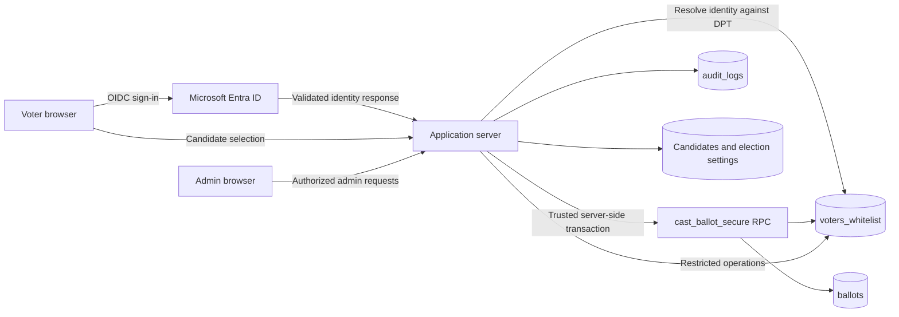

# Security Specification & Threat Model — E-Voting Pemira HMIF

| Metadata | Value |
|---|---|
| Document | Security Specification & Threat Model |
| Project | E-Voting Pemira HMIF |
| Version | 0.1.0 |
| Status | Draft — Requires Security Review |
| Basis | PRD v1.0.0, UI.md, ARCHITECTURE.md, DATABASE.md, API.md, AUTHENTICATION.md, and project context supplied in the conversation |
| Last updated | 2026-10-31 |

> **Status convention**
>
> - **Specified**: explicitly supported by the current PRD or project context.
> - **Proposed**: a security recommendation that has not yet been approved.
> - **TBD**: a security decision or implementation detail that remains unresolved.
>
> This document is a threat-model and control baseline. It is not a penetration-test report, certification, or proof that the implementation is secure.

---

## 1. Purpose and security objectives

This document identifies the security objectives, trust boundaries, threat scenarios, and verification activities for E-Voting Pemira HMIF.

The system must protect:

1. **Vote integrity** — each eligible voter can cast at most one valid vote, and recorded votes cannot be silently altered.
2. **Ballot secrecy** — a stored ballot must not directly identify the voter or reveal the voter's choice through the receipt/status interface.
3. **Eligibility integrity** — only identities matched to the authoritative DPT may enter the ballot flow.
4. **Availability** — legitimate voters must be able to access the system during the official voting window.
5. **Administrative integrity** — only authorized operators can modify DPT/election settings or access restricted results.
6. **Result confidentiality** — candidate tally remains private until the official release condition is met.
7. **Auditability** — privileged and operational changes can be investigated without creating a voter-to-ballot correlation path.

## 2. Scope

### 2.1 In scope

- Microsoft Entra authentication and identity-to-DPT mapping.
- Application sessions and authorization.
- Voter status and ballot booth.
- Ballot-casting application service and PostgreSQL RPC.
- Supabase/PostgreSQL access controls, RLS, grants, and `SECURITY DEFINER`.
- DPT import and administrative override.
- Election settings, tally, turnout, and report export.
- Audit logs and application/hosting logs.
- Deployment secrets and operational configuration.
- Abuse, concurrency, and availability risks.

### 2.2 Out of scope or not yet specified

The PRD explicitly excludes in-app live debate/Q&A, voter self-registration, and public tally during active voting.

The current source documents do not define:

- A formal external penetration-test scope.
- A cryptographic end-to-end verifiable voting protocol.
- A public independent verification mechanism.
- A formal incident-response organization or SLA.
- A formal data-retention schedule.
- A disaster-recovery RTO/RPO.
- A formal security certification target.

Do not claim that the application provides end-to-end verifiable elections unless such a protocol is separately designed, implemented, and independently assessed.

## 3. Assets and security impact

| Asset | Security property | Impact if compromised |
|---|---|---|
| Entra identity/session | Authenticity and confidentiality | Account impersonation or unauthorized access |
| DPT (`voters_whitelist`) | Integrity and confidentiality | Ineligible voting, voter exclusion, identity exposure |
| Candidate records | Integrity and availability | Incorrect or unavailable ballot choices |
| Ballot records | Integrity and secrecy | Election result manipulation or disclosure |
| Election settings | Integrity | Unauthorized opening/closing or disruption of voting |
| Tally data | Confidentiality and integrity | Premature result disclosure or result manipulation |
| Admin privileges | Confidentiality and integrity | Broad administrative compromise |
| Audit records | Integrity and controlled confidentiality | Loss of accountability or exposure of sensitive data |
| Receipt token | Authenticity and privacy | False confirmation, replay, or unintended correlation |
| Secrets / service-role credentials | Confidentiality | Privileged database or infrastructure compromise |
| Backups and exports | Confidentiality and integrity | Bulk data disclosure or tampering |

## 4. Trust boundaries and data flows

### 4.1 Trust boundaries

1. **Browser boundary:** all browser input is untrusted, including hidden fields and client-side state.
2. **Identity-provider boundary:** Entra is the external identity provider; the application must validate its protocol responses.
3. **Application-server boundary:** server-side code is responsible for identity mapping, authorization, validation, and privileged operations.
4. **Database boundary:** Supabase/PostgreSQL enforces transaction integrity and database permissions. Browser clients must not receive unrestricted privileged access.
5. **Administrative boundary:** admin operations require explicit server-side authorization and auditability.
6. **Operations boundary:** hosting, reverse proxy, analytics, monitoring, backups, and logs may hold data that can undermine ballot secrecy if configured carelessly.

### 4.2 High-level data flow

This diagram is logical. It does not establish the actual deployed network topology or prove that every database permission is configured correctly.

## 5. Threat modeling approach

Threat scenarios are organized around common security properties: spoofing, tampering, repudiation, information disclosure, denial of service, and privilege escalation.

Risk rating is qualitative:

- **Critical:** could invalidate election integrity or expose ballot choices at scale.
- **High:** could materially compromise eligibility, results, privacy, or administrative control.
- **Medium:** limited impact or requires additional conditions.
- **Low:** limited security impact.

Ratings are preliminary and must be revisited after architecture and deployment details are confirmed.

## 6. Threat register

| ID | Threat / abuse case | Impact | Preliminary risk | Required mitigation / status |
|---|---|---|---|---|
| SEC-01 | Attacker forges or reuses an invalid identity token | Impersonation | High | Validate signature, issuer, audience, expiry, tenant, nonce/state through trusted OIDC implementation |
| SEC-02 | User changes client-supplied NIM to vote as another student | Unauthorized vote | Critical | Derive NIM from validated server-side identity-to-DPT mapping; never trust browser-supplied NIM |
| SEC-03 | Two concurrent requests cast votes for one voter | Double voting | Critical | Atomic database transaction and row lock; verify one SUCCESS and remaining ALREADY_VOTED |
| SEC-04 | Database RPC can be invoked by an untrusted database role | Bypass application authorization | Critical | Restrict EXECUTE grants; review SECURITY DEFINER owner, search_path, and function privileges |
| SEC-05 | Ballot row or logs include voter identifiers | Ballot secrecy failure | Critical | Prohibit direct identifiers and correlation fields in ballot data; inspect all logging layers |
| SEC-06 | Admin tally endpoint is accessible to a student | Premature result disclosure | High | Server-side role check; PRD requires HTTP 403 for regular student |
| SEC-07 | Admin account is compromised | DPT/settings/result manipulation | Critical | Least privilege, strong account protection, restricted provisioning, audit and revocation controls |
| SEC-08 | DPT import overwrites or corrupts valid records | Eligibility manipulation | High | Preview, validation, duplicate detection, transaction/rollback policy, audit trail |
| SEC-09 | Candidate ID is modified to select an inactive or invalid candidate | Invalid ballot | High | Server-side candidate validation and database constraint / RPC validation |
| SEC-10 | Voting window or maintenance mode is changed without authorization | Election disruption | High | Role-based server authorization, audit event, strict settings validation |
| SEC-11 | Receipt token is guessed, forged, or treated as proof without persistence | False confirmation / privacy risk | Medium–High | Define receipt semantics; use unguessable server-generated token if it is intended as a verifiable receipt |
| SEC-12 | SQL injection or unsafe dynamic SQL compromises database | Data disclosure / tampering | High | Parameterized queries, safe ORM/RPC use, validation, least-privilege DB roles |
| SEC-13 | XSS steals session context or manipulates voter UI | Account compromise / vote manipulation | High | Output encoding, safe rendering, CSP where feasible, dependency review, avoid unsafe HTML |
| SEC-14 | CSRF triggers a privileged state-changing action | Unauthorized changes | High | Appropriate SameSite policy, anti-CSRF controls, origin checks for cookie-authenticated mutations |
| SEC-15 | Open redirect or callback manipulation abuses OIDC flow | Authentication compromise | High | Strict redirect URI allowlist, state/correlation checks, safe post-login destinations |
| SEC-16 | Automated traffic overwhelms login or voting services | Availability loss | High | Rate limiting, capacity testing, monitoring, controlled degradation |
| SEC-17 | Admin exports or backups expose DPT data | Bulk privacy breach | High | Restrict export, minimize fields, secure storage, access logs, retention/deletion policy |
| SEC-18 | Operational logs correlate login time and ballot insertion time | Ballot secrecy degradation | Critical | Minimize timestamps and identifiers; review proxy, app, database, analytics, and monitoring logs together |
| SEC-19 | Role removal does not affect existing sessions | Persistent unauthorized access | High | Define revocation strategy and short-lived authorization context; test role-change propagation |
| SEC-20 | Missing or misconfigured RLS exposes tables through Supabase client | Data disclosure / tampering | Critical | Explicit RLS policies, grants review, and tests using anonymous/authenticated roles |
| SEC-21 | Backup restore or migration introduces duplicate/missing vote state | Result inconsistency | High | Tested migration/backup/restore procedure and integrity reconciliation |
| SEC-22 | Error responses expose SQL details, tokens, or personal data | Information disclosure | Medium | Safe error envelopes; server-side restricted diagnostics |
| SEC-23 | Admin manually changes `has_voted` without a controlled process | Eligibility / double-vote state corruption | High | Restrict overrides, require reason and audit record, define approval policy |
| SEC-24 | Tally or turnout aggregates reveal small-group participation patterns | Inference / privacy leakage | Medium–High | Separate turnout and tally policies; consider small-group suppression and timing controls |

## 7. Critical security design rules

### 7.1 Identity must be server-derived

The PRD RPC signature accepts `p_nim`. That parameter is sensitive because a client-controlled NIM could allow impersonation if the server forwards it without checking the authenticated identity.

**Required rule:** the server resolves the authenticated Entra identity to exactly one DPT record and obtains the NIM from that trusted record. The browser submits only the candidate selection.

The database function must also be protected from direct invocation by unauthorized roles. Application-layer checks alone are insufficient if the RPC is exposed to a database role that can call it with arbitrary NIM values.

### 7.2 Ballot secrecy is an end-to-end property

The PRD prohibits voter identifiers and precise timestamps in `ballots`. That is necessary but not sufficient.

Review the complete path:

- Database columns and foreign keys.
- RPC parameters and return values.
- Application request/response logs.
- Reverse-proxy and hosting logs.
- Analytics and error monitoring.
- Backups and exported reports.
- Admin dashboard and support workflows.

A ballot table without `voter_id` can still be correlated with a voter if precise request timestamps and identity-bearing logs are retained elsewhere.

### 7.3 Atomic vote casting

The authoritative vote transaction must:

1. Check voting availability.
2. Lock the corresponding voter row.
3. Reject unknown or already-voted voters.
4. Validate that the candidate is active.
5. Update the voter participation state.
6. Insert exactly one ballot.
7. Commit all state changes atomically.

If any required operation fails, the transaction must not leave a voter marked as having voted without a ballot, or a ballot inserted without the corresponding participation update.

### 7.4 Tally and turnout are different data products

Candidate tally reveals candidate preference. Turnout reports participation only.

Do not implement one broad endpoint that returns both datasets to every dashboard user. Define distinct permissions and release conditions.

The PRD says candidate tally remains private until official close and public tally is out of scope during active voting. It does not fully define which administrators may see tally before close. That policy remains a release-blocking decision.

### 7.5 Administrative override

Any manual change to DPT records or voter participation state is high impact.

**Proposed minimum controls:**

- Dedicated permission, not generic admin access.
- Require a reason for the action.
- Record actor, action, target record, and before/after values where safe.
- Prevent editing ballot rows through the override workflow.
- Consider a second-person approval for changes that affect eligibility or participation.
- Define how an override is reconciled with existing ballots.

The exact approval policy is TBD.

## 8. Database and Supabase hardening

The following controls must be verified against the actual Supabase project and migration files.

### 8.1 Row Level Security and grants

- [ ] Confirm RLS is enabled on every table exposed through client-accessible Supabase APIs.
- [ ] Define explicit policies for anonymous, authenticated, and privileged roles.
- [ ] Ensure students cannot read the full DPT.
- [ ] Ensure students cannot read ballot rows or candidate tally.
- [ ] Ensure students cannot write ballots directly outside the approved RPC.
- [ ] Ensure students cannot modify `has_voted`.
- [ ] Ensure admin permissions are scoped to required operations.
- [ ] Review table grants in addition to RLS policies.
- [ ] Test with actual anon/authenticated database roles, not only service-role credentials.

RLS does not replace database grants, and service-role credentials must never be exposed to the browser.

### 8.2 SECURITY DEFINER RPC

The PRD defines `cast_ballot_secure` as `SECURITY DEFINER`.

Before release, verify:

- Function owner is a deliberately selected least-privileged role.
- `search_path` is explicitly pinned to trusted schemas.
- All table and function references are schema-qualified where appropriate.
- EXECUTE permission is granted only to the intended caller role.
- Untrusted users cannot create objects in schemas searched by the function.
- Inputs are validated and constrained.
- The function does not return sensitive voter or ballot data.
- Error behavior does not disclose internal database details.
- Direct RPC invocation cannot bypass the identity-to-DPT authorization boundary.

**Release blocker:** If an untrusted role can call the function with an arbitrary NIM, the function must independently bind the request to a trusted identity context or the database access model must be changed.

### 8.3 Integrity constraints

Review whether the schema needs:

- Foreign keys with appropriate delete behavior.
- Unique constraints on DPT identity fields.
- Candidate active-state validation.
- A singleton constraint for election settings.
- Explicit transaction handling and migration checks.
- Protection against deleting candidates already referenced by ballots.

Do not add constraints blindly: confirm intended product behavior and migration impact first.

## 9. Application-layer hardening

### 9.1 Input validation

Validate all external input on the server:

- UUIDs and candidate identifiers.
- DPT CSV/XLSX structure and size.
- NIM/email values.
- Election settings and time ranges.
- Report format and export parameters.
- Admin override payloads.

Use parameterized database access. Do not construct SQL by concatenating untrusted input.

### 9.2 Session and browser security

The PRD requires HTTP-Only, Secure, and SameSite=Strict cookies, and states a maximum 15-minute JWT lifetime in the ballot booth.

The exact token/session interpretation and SameSite compatibility with the Entra callback remain unresolved. Verify the complete login, callback, refresh, logout, and vote flow in production-like browsers.

Additional proposed controls:

- Content Security Policy appropriate to the actual app and identity provider.
- Strict redirect URI allowlist.
- Safe external-link handling.
- Dependency and lockfile review.
- Security headers appropriate to the deployment.
- No tokens or secrets in client logs, analytics, or URLs.

### 9.3 Error handling

Return stable, safe error codes to the client. Do not expose:

- SQL statements.
- Stack traces.
- Service-role credentials.
- Raw identity tokens.
- Internal table names where not needed.
- Other voters' personal information.

Keep restricted diagnostic details in access-controlled server logs.

## 10. Availability and abuse resistance

The PRD specifies performance goals including vote casting under 400 ms at 100 concurrent requests and support for 500 active users. These are performance targets, not proof of denial-of-service resilience.

Proposed controls:

- Rate-limit authentication and administrative endpoints.
- Apply upload size and row-count limits to DPT import.
- Monitor error rate, latency, database connection pressure, and RPC failures.
- Test peak concurrent traffic and repeated requests.
- Define safe behavior when the database or identity provider is unavailable.
- Avoid a fallback mode that permits voting without authoritative DPT and transaction checks.
- Ensure retries do not create duplicate votes.
- Prepare an operational procedure for pausing voting if integrity cannot be guaranteed.

**TBD:** Rate limits, capacity assumptions, hosting protections, monitoring thresholds, and incident decision authority.

## 11. Audit, monitoring, and incident response

### 11.1 Audit events

The PRD includes `audit_logs` with `actor_email`, `action`, `details`, `ip_address`, and `created_at`.

Potential auditable events include:

- Admin sign-in and privileged access.
- DPT import and override.
- Election settings changes.
- Tally access.
- Report export.
- Role changes.
- Maintenance mode changes.

Audit logs must not include candidate choice, raw tokens, or a mapping from voter identity to ballot.

**Privacy warning:** `actor_email`, IP address, and precise timestamps are personal or correlatable data. Their access, purpose, retention, and relation to ballot secrecy must be reviewed. Do not log ballot-casting events with identity and precise time in a way that can be joined to ballot insertion order/time.

### 11.2 Incident response minimum

**Proposed operational sequence:**

1. Detect and classify the incident.
2. Preserve relevant logs and evidence with restricted access.
3. Determine whether confidentiality, integrity, or availability is affected.
4. If vote integrity or ballot secrecy cannot be guaranteed, escalate to the authorized election decision-maker and consider pausing voting.
5. Contain compromised credentials or privileges.
6. Restore service only after integrity checks and approval.
7. Document impact, timeline, actions, and follow-up controls.

**TBD:** Name the responsible incident commander, election authority, communication owner, and criteria for pausing/reopening voting.

## 12. Security verification plan

| Test ID | Verification | Expected result |
|---|---|---|
| SEC-T01 | Attempt vote using another student's NIM in request body | Rejected or ignored; caller can only act as own mapped DPT identity |
| SEC-T02 | Call ballot RPC as unauthorized database role | EXECUTE denied |
| SEC-T03 | Call ballot RPC with arbitrary NIM through an allowed but untrusted path | Cannot impersonate another voter |
| SEC-T04 | Five concurrent ballot requests for one NIM | Exactly one SUCCESS and four ALREADY_VOTED |
| SEC-T05 | Submit inactive / unknown candidate ID | Rejected; no ballot inserted |
| SEC-T06 | Inspect `ballots` schema and rows | No voter identifier or precise timestamp |
| SEC-T07 | Inspect app, proxy, DB, and monitoring logs | No practical voter-to-candidate correlation path |
| SEC-T08 | Access `/api/admin/tally` as regular student | HTTP 403 |
| SEC-T09 | Access DPT records using student role | No unauthorized DPT disclosure |
| SEC-T10 | Attempt direct client write to `ballots` | Denied |
| SEC-T11 | Attempt direct client update to `has_voted` | Denied |
| SEC-T12 | Invoke admin settings operation as student | HTTP 403 |
| SEC-T13 | Upload malformed or oversized DPT file | Rejected safely; no partial unintended mutation |
| SEC-T14 | Test XSS payload in candidate / DPT text fields | Rendered as data, not executable script |
| SEC-T15 | Test CSRF against state-changing admin action | Request rejected or protected |
| SEC-T16 | Test OIDC state, nonce, issuer, audience, and redirect validation | Invalid flow rejected |
| SEC-T17 | Reuse expired or revoked session | Protected operation rejected |
| SEC-T18 | Test role revocation during an active session | Access removed according to approved revocation policy |
| SEC-T19 | Attempt to read tally before authorized release | Denied according to approved role and election-state policy |
| SEC-T20 | Simulate lost response after successful vote commit and retry | No duplicate ballot; state remains consistent |
| SEC-T21 | Restore a backup in a test environment | Voter state and ballot aggregates reconcile |
| SEC-T22 | Review report exports | Only approved fields are included and access is restricted |

These are required test scenarios, not evidence that the tests have already passed.

## 13. Release security gates

The following items should block production launch until resolved and verified:

1. Identity-to-DPT mapping is trusted and cannot be overridden by client input.
2. Unauthorized roles cannot call privileged ballot RPC functions.
3. RLS and database grants are reviewed and tested.
4. `SECURITY DEFINER` configuration is hardened.
5. Ballot records and operational logs do not create a voter-to-choice correlation path.
6. Concurrent voting produces exactly one successful ballot per voter.
7. Students cannot access private tally or administrative operations.
8. Admin role provisioning and revocation are defined.
9. Receipt semantics do not overstate proof of a committed ballot.
10. DPT import and override operations have controlled transaction and audit behavior.
11. Backup/restore and incident pause procedures are defined.
12. Security tests run against a production-like environment.

## 14. Open decisions

| ID | Decision required | Why it matters |
|---|---|---|
| SEC-DEC-01 | Formal security and privacy threat-model owner | Assigns accountability |
| SEC-DEC-02 | Entra claim and DPT identity mapping | Prevents impersonation |
| SEC-DEC-03 | Database RPC caller identity enforcement | Prevents direct RPC abuse |
| SEC-DEC-04 | SECURITY DEFINER owner, search_path, and grants | Prevents privilege escalation |
| SEC-DEC-05 | Complete RLS and table-grant matrix | Prevents unauthorized data access |
| SEC-DEC-06 | Tally visibility policy during active voting | Protects result confidentiality |
| SEC-DEC-07 | Turnout visibility and small-group aggregation policy | Reduces inference risk |
| SEC-DEC-08 | Application and infrastructure logging policy | Protects ballot secrecy |
| SEC-DEC-09 | Audit log access and retention | Balances accountability and privacy |
| SEC-DEC-10 | Admin role provisioning, approval, and revocation | Controls privileged access |
| SEC-DEC-11 | DPT import atomicity and override controls | Protects eligibility integrity |
| SEC-DEC-12 | Receipt token design and verification semantics | Prevents false or misleading proof |
| SEC-DEC-13 | Rate limits and capacity / DoS protection | Protects availability |
| SEC-DEC-14 | Backup, restore, and disaster-recovery objectives | Protects continuity and data integrity |
| SEC-DEC-15 | Incident response authority and voting pause criteria | Enables safe response |
| SEC-DEC-16 | External security testing scope and timing | Provides independent assurance |
| SEC-DEC-17 | Data retention and deletion schedule | Controls long-term exposure |

## 15. Completion criteria

This document can move from Draft to Approved when:

1. The threat register has been reviewed by the technical and election stakeholders.
2. Critical and high-risk threats have assigned owners and mitigations.
3. Database grants, RLS, and privileged RPC behavior have been verified.
4. Identity mapping and ballot authorization are tested against impersonation.
5. Ballot secrecy is reviewed across database and operational logs.
6. Tally and turnout release policies are approved.
7. Admin privilege and override workflows are controlled and audited.
8. Security verification scenarios are implemented and results recorded.
9. Incident response and backup/restore procedures are documented.
10. Release-blocking security gates are passed.

## 16. Next document

**Next in sequence: `TESTING.md`** — test strategy, test layers, functional scenarios, concurrency tests, privacy/security checks, and release acceptance criteria.

---

## Change log

| Version | Date | Changes |
|---|---|---|
| 0.1.0 | 2026-10-31 | Initial threat model and security-control baseline based on current project documentation |

## Entra multitenant restriction and personal tenant ownership (2026-10-31)

The project owner will create and personally manage the Entra tenant. The app registration will be multitenant to permit sign-in from Telkom University accounts, but the application must validate the token and allow only the verified Telkom University tenant ID (`tid`). Never treat multitenant configuration or an email suffix check as sufficient authorization. Validate signature, issuer, audience, expiry, nonce/state, and tenant using a trusted OIDC implementation.

The DPT comes from KEMA for cohorts 2023–2026 and contains `nim`, `email`, `name`, and `generation`. After token validation, match the institutional email to exactly one DPT row; then bind the verified `tid` + `oid` pair. Fail closed for missing/ambiguous DPT matches, unsupported tenant, or conflicting identity binding.

Because tenant ownership remains personal by decision, require MFA, at least one documented recovery method, secure storage of credentials, credential-expiry monitoring, and a continuity plan. This is an accepted governance risk, not an institutional ownership arrangement.

## Addendum — Approved RBAC and dummy-auth safeguards (2026-10-31)

The approved roles are `kpr_admin`, `auditor`, and `super_admin`, with voter eligibility maintained separately in the DPT. The permission matrix is authoritative in `AUTHENTICATION.md`. Administrative role membership is resolved from the database-backed `admin_users` whitelist using validated Entra `tid` + `oid`. Entra authentication does not itself confer admin rights.

No administrator role may inspect individual ballot rows or establish a voter-to-ballot link. `super_admin` manages access and technical configuration but has no default pre-close tally permission. `auditor` is read-only and cannot mutate DPT, candidates, or election settings. All privileged actions and role lifecycle changes must be audited.

Initial testing uses synthetic identities and an isolated mock authentication provider. The dummy provider must be environment-gated, disabled by default outside development/test, and fail closed in production. It must not bypass DPT checks, RBAC, or the real database authorization boundaries. Real Telkom Entra integration testing occurs only after the official tenant ID is obtained.

## Kontrol Keamanan Operasional — Insiden dan Pemulihan

- Perubahan status voting hanya dapat dilakukan oleh KPR Admin yang terotorisasi.
- Maintenance darurat hanya dapat diaktifkan oleh Superadmin yang terotorisasi.
- Perubahan status wajib menyertakan alasan dan dicatat dalam audit log.
- Pemulihan layanan oleh Superadmin tidak otomatis membuka voting kembali; keputusan melanjutkan berada pada KPR Admin.
- Status transaksi suara harus ditentukan dari database. Implementasi voting harus idempotent terhadap retry dan menjaga invariant One-Man-One-Vote.
- Pemeriksaan status transaksi tidak boleh mengungkap kandidat yang dipilih.
- Log tidak boleh menyimpan access token, refresh token, password, atau pilihan kandidat.

## Kontrol Keamanan Publikasi Hasil

- Endpoint dashboard publik hanya menyajikan agregat yang telah disahkan dan dipublikasikan.
- Endpoint publik tidak boleh menyediakan data pemilih individual, receipt token, atau relasi identitas dengan ballot.
- Live count tidak boleh tersedia untuk publik sebelum voting ditutup dan hasil disahkan.
- PDF dan dashboard harus menggunakan sumber rekapitulasi final yang sama.
- Koreksi hasil wajib menghasilkan versi baru dan audit trail; jangan menghapus jejak versi terdahulu.
- Statistik kelompok angkatan harus dievaluasi terhadap risiko identifikasi tidak langsung; ambang agregasi minimum masih TBD.

## Kontrol Retensi dan Arsip

- Terapkan retensi DPT dan pemetaan identitas Entra selama 1 tahun setelah hasil disahkan; setelah itu hapus atau anonimisasi sesuai kebijakan, kecuali data terkena legal hold.
- Arsip ballot secara permanen hanya dalam bentuk anonim. Dilarang menyimpan identitas atau identifier yang memungkinkan ballot dihubungkan kembali ke pemilih.
- Simpan hash receipt paling lama 1 tahun setelah hasil disahkan, kecuali legal hold; jangan menyimpan token receipt mentah.
- Audit log dapat diarsipkan permanen hanya setelah minimisasi data. Jangan mencatat password, access token, refresh token, receipt mentah, atau pilihan kandidat.
- Legal hold menangguhkan penghapusan hanya untuk data yang relevan sampai sengketa/pemeriksaan selesai.
- Arsip permanen harus memiliki kontrol akses least-privilege, proteksi backup, dan pencatatan akses.

## Kontrol Kepemilikan dan Serah Terima

- HMIF harus memiliki akses organisasi yang berkelanjutan terhadap source code, deployment, database, backup, domain, dan dokumentasi.
- Minimal dua administrator teknis organisasi ditetapkan; jangan menjadikan satu akun personal sebagai satu-satunya jalur pemulihan.
- MFA wajib untuk akun pemilik dan administrator.
- Simpan secret di secret manager; jangan commit atau memasukkan secret ke dokumen.
- Tinjau dan cabut akses pengurus/pengelola yang tidak lagi berwenang.
- Tenant Entra personal harus dimigrasikan atau dikelola melalui pengaturan formal yang menjamin kesinambungan akses sebelum produksi.
